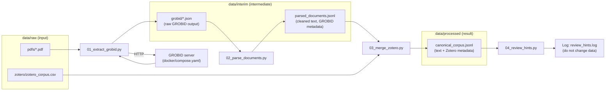

# Corpus Pipeline

The pipeline turns the PDFs into the canonical representation of the corpus (`data/processed/canonical_corpus.jsonl`). It does not perform any RAG steps.



## Steps

| Script | Input | Output | Purpose |
|---|---|---|---|
| `pipeline/01_extract_grobid.py` | `data/raw/pdfs/` | `data/interim/grobid/` | Convert PDFs into structured JSON via GROBID. GROBID only performs text and structure extraction. |
| `pipeline/02_parse_documents.py` | `data/interim/grobid/` | `data/interim/parsed_documents.jsonl` | Clean the text, derive the section hierarchy, assign stable `paragraph_id`s. Each paragraph has a `type` of `text`, `formula`, or `caption`. Bullet markers and empty residues are removed. |
| `pipeline/03_merge_zotero.py` | `data/interim/parsed_documents.jsonl`, `data/raw/zotero/zotero_corpus.csv` | `data/processed/canonical_corpus.jsonl` | Take bibliographic metadata and abstracts from Zotero. Matching by DOI, otherwise by normalized title. |
| `pipeline/04_review_hints.py` | `data/processed/canonical_corpus.jsonl` | `data/interim/logs/review_hints.log` | Flag spots that should be checked manually. The data stays unchanged. |
| `pipeline/00_run_all.py` | - | - | Runs steps 01 to 04 in order and stops on the first error. |

The scripts run from the repository root because the paths are relative.

## Execution

```bash
docker compose -f docker/compose.yaml up -d
uv sync
uv run python pipeline/00_run_all.py
```

To run the steps individually:

```bash
uv run python pipeline/01_extract_grobid.py
uv run python pipeline/02_parse_documents.py
uv run python pipeline/03_merge_zotero.py
uv run python pipeline/04_review_hints.py
```

## Data folder

`data/` is fully listed in `.gitignore`. The files contain full text and metadata from third-party publications. The scripts regenerate everything, so nothing of your own is lost. The exception is the Zotero export: it has to be exported again from Zotero manually.
